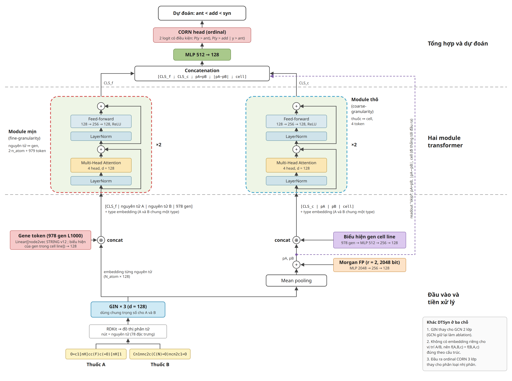

# Dự định triển khai:

Bài toán: sử dụng bộ 3 (thuốc A, B và gene C) chạy đi qua mô hình học máy để đưa ra dự đoán hiệp đồng thuốc với 3 nhãn syn/add/ant kèm theo đó là XAI để giải thích cho mô hình. input đầu vào sử dụng SMILES, biểu hiện gen, PPI, morgan fingerprints (Emilio Nuñez-Andrade et. al wiley advanced 2026)

---

## 1. Dữ liệu

### nguồn dữ liệu sử dụng cho project

| Nguồn | Dữ liệu lấy được từ nguồn đó |
|---|---|
| O'Neil (Merck 2016) qua DrugComb | thuốc (38 thuốc) và dòng tế bào (39 dòng) |
| ChEMBL API | SMILES của thuốc |
| DepMap / CCLE | biểu hiện gen |
| STRING | mạng PPI để huấn luyện node2vec |
| NCI-ALMANAC | tập kiểm chứng ngoài |

- Em sử dụng O'neil vì các bài báo cho bài toán hiệp đồng thuốc khác cũng sử dụng như là DTSyn, DeepDDS, AttenSyn và MD-Syn. sử dụng lại phần này có thể giúp mình đánh giá kết quả 1 cách công bằng hơn.

các thuốc sẽ được ánh xạ để tìm SMILES cũng như là các biểu hiện gen được

## 2. Mô hình

Khung gốc lấy từ **DTSyn** (Hu J. et al., *Brief Bioinform* 2022): hai transformer ở hai mức chi
tiết, token nguyên tử gặp token gen ở mức mịn, cả phân tử gặp cả phân tử ở mức thô, cộng embedding
gen từ node2vec trên PPI. Trên khung đó có ba thay đổi.

**GIN thay GCN.** Nhánh thuốc dùng GIN 2 lớp, chia sẻ trọng số cho cả A và B. GIN gộp láng giềng
bằng phép tổng chứ không phải trung bình có chuẩn hóa, nên nó phân biệt được hai cấu trúc mà GCN
gộp thành một. GCN 2 lớp đúng cấu hình DTSyn được giữ lại làm ablation để so.

**Fingerprint đi vào transformer thô.** Trước khi vào transformer thô, mỗi thuốc được gộp về một
vector duy nhất, và vector đó cộng cả hai nguồn:

```
p_A = mean( token nguyên tử của A )  +  fp_mlp( fingerprint của A )
p_B = mean( token nguyên tử của B )  +  fp_mlp( fingerprint của B )
```

Transformer thô 2 lớp, 4 đầu, chạy trên 4 token `[ CLS_c │ p_A │ p_B │ cell_mlp(expr) ]`. Lý do
đưa fingerprint vào đây: GNN chỉ học từ 38 thuốc, quá ít để tự dựng biểu diễn hóa học tốt, còn
fingerprint là biểu diễn có sẵn không cần học. Hai thuốc dùng chung type id nên lớp này đối xứng
A đổi B.

**Đầu ra CORN.** Thay vì softmax ba lớp, đầu ra dùng CORN (Shi, Cao, Raschka 2023), biến ba
lớp có thứ tự thành hai bài nhị phân có điều kiện. Dự đoán vì vậy không bao giờ mâu thuẫn về thứ
tự, và sai từ hiệp đồng thành đối kháng bị phạt nặng hơn sai thành cộng tính. Chỉ số chính là QWK,
chỉ số này chưa được dùng trong lĩnh vực hiệp đồng thuốc.

{width=100%}

---

## 3. Chia dữ liệu để đánh giá

Em chạy năm cách chia, cùng với cách mà DTSyn dùng, để số của mình đặt cạnh
số của họ được.

| Cách chia            | Cái gì bị giữ hẳn ra khỏi tập train     | Câu hỏi nó trả lời                                                             |
| --------------------- | ---------------------------------------------- | ----------------------------------------------------------------------------------- |
| random 5-fold         | không giữ gì, chia ngẫu nhiên theo bộ ba | mô hình có học được quy luật trong dữ liệu không                         |
| leave-combination-out | cả cặp thuốc (A,B)                          | gặp một cặp chưa từng thấy, nhưng cả hai thuốc đều đã thấy riêng lẻ |
| leave-drug-out        | một thuốc, mọi bộ ba chứa nó             | gặp một thuốc hoàn toàn mới                                                   |
| leave-cell-out        | một dòng tế bào                            | gặp một dòng tế bào mới                                                       |
| leave-tumor-out       | cả một loại mô, 7 loại                    | gặp một loại ung thư mới                                                       |

Thứ tự trong bảng là thứ tự từ dễ tới khó. Random 5-fold dễ nhất vì một cặp thuốc có thể xuất
hiện ở cả train và test, chỉ khác dòng tế bào. leave-drug-out khó nhất vì mô hình phải suy từ
cấu trúc hóa học chứ không được dựa vào việc đã thấy thuốc đó bao giờ.

---

## 4. Giải thích mô hình

Phương pháp quy gán dùng **Integrated Gradients**. Mô hình được thiết kế để nhận mặt nạ mềm ở ba
chỗ ngay từ đầu, nên phần giải thích không phải thứ gắn thêm sau khi huấn luyện xong:

| Mặt nạ    | Cắm ở đâu                                | Đơn vị giải thích                                                 |
| ----------- | -------------------------------------------- | ---------------------------------------------------------------------- |
| `μ_atom` | sau GIN, trước khi gộp về mức phân tử | từng nguyên tử, hoặc từng mảnh BRICS                             |
| `μ_fp`   | nhân vào đầu ra của `fp_mlp`          | cả nhánh fingerprint, để đo tỉ lệ đồ thị so với fingerprint |
| `μ_gene` | nhân vào biểu hiện, trước mọi lớp    | từng gen trong tập gen landmark                                      |

`μ_gene` nhân vào biểu hiện chứ không vào token đã mã hóa, nên khi μ = 0 thì gen đó bị đặt về
trung bình của tập train, vì biểu hiện đã z-score. Đó đúng là baseline mà Integrated Gradients
cần, một giá trị trung tính có nghĩa sinh học, không phải số 0 chọn bừa.

Quy gán chạy trên ba mục tiêu: `z_syn`, `z_syn − z_add`, và `z_ant − z_add`. Mục tiêu thứ ba là
chỗ mà cách đặt bài toán ba lớp trả được công, vì nó cho phép hỏi vì sao mô hình kết luận *đối
kháng*, câu hỏi mà mô hình nhị phân hiệp đồng hay không hiệp đồng không hỏi được.

Hướng đến ba thứ:

1. Giải thích ở đơn vị đọc được, nghĩa là mảnh BRICS về phía thuốc và gen về phía tế bào, chứ
   không phải một vector quy gán thô theo chiều.
2. Chấm điểm lời giải thích bằng gộp pathway KEGG để xem gen được chấm cao có tụ vào pathway có
   liên quan hay rải đều, kèm đối chứng null và đo độ ổn định giữa các seed. Điều này để tránh
   tình trạng lời giải thích nghe hợp lý nhưng không kiểm được.
3. Đo xem quyết định đi qua nhánh nào. Nhánh fingerprint không giải thích được theo mảnh cấu
   trúc, nên `μ_fp` tồn tại để biết bao nhiêu phần quyết định nằm ở nhánh không giải thích được.
   Tỉ lệ đó sẽ được báo cáo đúng như đo được, kể cả khi nó cao.

## 5. dự định làm project

Hiện tại e sẽ chia project ra làm 2 pha: 1 là dành cho mô hình, 2 là XAI.

- về phía mô hình thì ở đây e chỉ đang ghép nối các phần của các bài báo khác nhau lại với mong muốn giúp đỡ cho mô hình tổng quát đạt được một kết quả tốt hơn so với các mô hình trước đó chứ chưa phải là 1 mô hình quá đột phá về mặt kiến trúc
- về phần XAI, hiện tại thì e cũng có tham khảo 1 số cách giải thích XAI của 1 số bài liên quan đến hiệp đồng nhưng chưa chốt hẳn 1 giải pháp, hiện tại e sẽ sử dụng IG trước.

---

## Tài liệu tham khảo

**Khung và các bài cùng bài toán**

1. Hu J., Gao J., Fang X., Liu Z., Wang F., Huang W., Wu H., Zhao G. **DTSyn: a dual-transformer-based neural network to predict synergistic drug combinations.** *Briefings in Bioinformatics* 2022;23(5):bbac302 · code: https://github.com/PaddlePaddle/PaddleHelix/tree/dev/apps/drug_drug_synergy/DTSyn — khung chính mà em đi theo
2. Wang J., Liu X., Shen S., Deng L., Liu H. **DeepDDS: deep graph neural network with attention mechanism to predict synergistic drug combinations.** *Briefings in Bioinformatics* 2022;23(1):bbab390 · arXiv:2107.02467 — nguồn của đặc trưng nguyên tử và cách gộp readout
3. Wang T., Wang R., Wei L. **AttenSyn: An Attention-Based Deep Graph Neural Network for Anticancer Synergistic Drug Combination Prediction.** *Journal of Chemical Information and Modeling* 2024
4. **MD-Syn: a multi-dimensional deep learning framework for synergistic drug combination prediction.** *Frontiers in Pharmacology* 2025;16:1564339 · arXiv:2501.07884

**Các thành phần em thay hoặc thêm vào khung đó**

5. Xu K., Hu W., Leskovec J., Jegelka S. **How Powerful are Graph Neural Networks?** *ICLR* 2019 · arXiv:1810.00826 — GIN, lý do thay GCN
6. Shi X., Cao W., Raschka S. **Deep Neural Networks for Rank-Consistent Ordinal Regression Based on Conditional Probabilities.** *Pattern Analysis and Applications* 2023;26:941–955 · arXiv:2111.08851 — CORN, đầu ra thứ tự
7. Rogers D., Hahn M. **Extended-Connectivity Fingerprints.** *Journal of Chemical Information and Modeling* 2010;50(5):742–754 — Morgan fingerprint
8. Nuñez-Andrade E. et al. Wiley, 2026 — bài em dẫn cho việc dùng Morgan fingerprint; cần điền tên bài, tạp chí và số trang
9. Grover A., Leskovec J. **node2vec: Scalable Feature Learning for Networks.** *KDD* 2016:855–864 · arXiv:1607.00653 — embedding gen trên mạng PPI

**Phương pháp giải thích**

10. Sundararajan M., Taly A., Yan Q. **Axiomatic Attribution for Deep Networks.** *ICML* 2017:3319–3328 · arXiv:1703.01365 — Integrated Gradients
11. Janizek J.D., Sturmfels P., Lee S.-I. **Explaining Explanations: Axiomatic Feature Interactions for Deep Networks.** *Journal of Machine Learning Research* 2021;22(104):1–54 · arXiv:2002.04138 — Integrated Hessians
