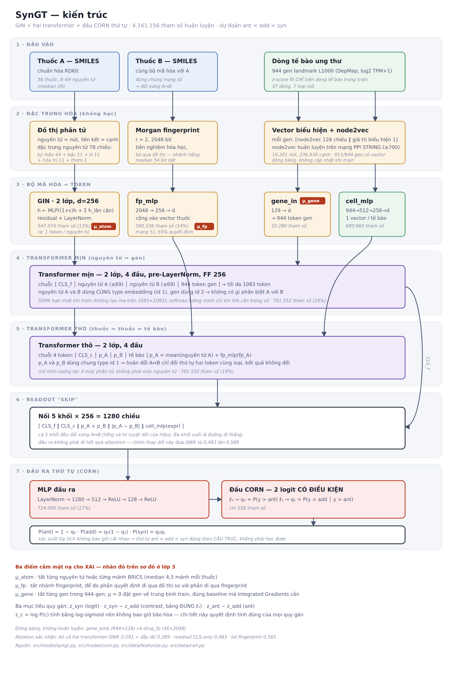

# Kiến trúc SynGT — giải thích từng lớp



*Sơ đồ: `reports/figures/syngt_architecture.png` (bản vector: `syngt_architecture.svg`).*

Mã nguồn: `src/model/syngt.py` (mô hình), `src/model/corn.py` (đầu ra thứ tự),
`src/data/featurize.py` (thuốc), `src/data/cell.py` (tế bào).

---

## 0. Bài toán và ý tưởng một câu

Cho một **bộ ba** (thuốc A, thuốc B, dòng tế bào ung thư), dự đoán tác động của cặp thuốc đó
trên dòng tế bào đó là **đối kháng (ant) < cộng tính (add) < hiệp đồng (syn)**.

Ý tưởng: hai thuốc tương tác với nhau ở **hai mức độ chi tiết khác nhau**. Ở mức *mịn*, từng
nhóm nguyên tử của thuốc này gặp từng gen của tế bào. Ở mức *thô*, cả phân tử A gặp cả phân tử B
trong bối cảnh của tế bào. SynGT dựng một transformer cho mỗi mức. Đây là thiết kế của **DTSyn**;
phần của chúng tôi là ba thay đổi có chủ đích, nêu ở §9.

Tổng cộng **4.161.156 tham số huấn luyện**, cộng hai bảng tra đóng băng (gene_emb 944×128,
drug_fp 36×2048) không được cập nhật.

---

## 1. Dữ liệu vào — mỗi nguồn dùng để làm gì

| Nguồn | Hình dạng | Dùng để làm gì | Đi vào nhánh nào |
|---|---|---|---|
| SMILES của thuốc | 36 thuốc | cấu trúc hóa học, cái mà mô hình phải tổng quát hóa sang thuốc mới | đồ thị phân tử + fingerprint |
| Biểu hiện gen | 37 × 944 | bối cảnh sinh học: cùng cặp thuốc cho kết quả khác nhau trên tế bào khác nhau | token gen + cell_mlp |
| Mạng PPI STRING | 16.201 nút, 236.930 cạnh | tiên nghiệm: gen tương tác nhau thì nên có biểu diễn gần nhau | node2vec, đóng băng |
| Điểm synergy Loewe | 18.870 giá trị | nhãn, qua ngưỡng ±10 | hàm mất mát |

Ba điểm quan trọng về cách dùng dữ liệu:

- **Biểu hiện gen được z-score chỉ trên các dòng tế bào có trong tập train** của từng fold. Giá
  trị trung bình và độ lệch chuẩn không bao giờ nhìn thấy tế bào trong test.
- **node2vec đóng băng.** Nó là kiến thức ngoài, không phải tham số học được, nên không thể học
  thuộc dữ liệu huấn luyện. Có một bản đối chứng `gene_emb_rewired` xáo mạng nhưng giữ nguyên bậc
  của từng nút, để trả lời câu hỏi: mạng PPI thật có hơn một mạng giả cùng cấu trúc bậc không?
  (Câu trả lời thực nghiệm: gần như không — 0,586 so với 0,585.)
- **Điểm synergy thô được giữ lại** bên cạnh nhãn rời rạc, vì hàm mất mát label smoothing cần
  biết một bộ ba nằm *cách ngưỡng bao xa*, không chỉ nằm bên nào.

---

## 2. Lớp đặc trưng hóa (không có tham số học)

### 2.1 Đồ thị phân tử — đặc trưng nguyên tử 78 chiều

Mỗi phân tử thành một đồ thị: nguyên tử là nút, liên kết hóa học là cạnh. Mỗi nguyên tử mang
vector 78 chiều, toàn bộ là one-hot:

| Thành phần | Số chiều | Nói lên điều gì |
|---|---|---|
| ký hiệu nguyên tố | 44 | C, N, O, S, halogen… |
| bậc (số liên kết) | 11 | nguyên tử này nối với mấy nguyên tử khác |
| tổng số H | 11 | mức độ bão hòa hydro |
| hóa trị ẩn | 11 | còn chỗ cho liên kết nữa không |
| tính thơm | 1 | có nằm trong vòng thơm không |

Đây đúng là vector của **GraphDRP / DeepDDS**, và DTSyn cũng dùng. Chọn giống để nhánh thuốc
so sánh được trực tiếp với các bài đó, chứ không phải vì nó tối ưu.

### 2.2 Morgan fingerprint — nhánh song song, cố ý bỏ qua đồ thị

Fingerprint Morgan bán kính 2, 2048 bit: mỗi bit cho biết một *mẫu vòng tròn* quanh một nguyên tử
có xuất hiện trong phân tử hay không. Trung vị 54 bit bật trên 2048.

Vì sao giữ nhánh này trong khi đã có GNN? Vì **GNN học từ 36 thuốc là quá ít**. Fingerprint là
biểu diễn hóa học có sẵn, không cần học. Thực nghiệm: bỏ nó đi QWK rơi từ 0,589 xuống 0,565.
Cái giá phải trả là nó không giải thích được theo mảnh cấu trúc — nên nó được cấp **một mặt nạ
XAI riêng** (`μ_fp`) để đo đúng phần quyết định đi qua nó. Kết quả: fingerprint mang **51–55%**
quyết định. Đây là một con số phải báo cáo, không phải giấu đi.

### 2.3 Token gen — ghép node2vec với biểu hiện

Mỗi gen thành một vector 129 chiều: `[node2vec 128 chiều ‖ giá trị biểu hiện đã z-score 1 chiều]`.

Cách ghép này tách bạch hai loại thông tin: **gen này là gen gì** (node2vec, giống nhau ở mọi
dòng tế bào) và **gen này đang bật mạnh hay yếu ở dòng tế bào này** (biểu hiện, thay đổi theo
từng bộ ba). 33 trong 944 gen không có trong STRING ở ngưỡng score ≥ 700 nên nhận vector toàn 0;
chúng vẫn giữ được giá trị biểu hiện của mình.

---

## 3. Lớp 3 — bốn bộ mã hóa chạy song song

### 3.1 GIN, 2 lớp, d = 256 — 547.074 tham số

Mỗi lớp cập nhật biểu diễn của một nguyên tử bằng chính nó cộng tổng các lân cận:

```
h ← LayerNorm( h + Dropout(ReLU( MLP( (1+ε)·h + Σ_lân cận h ) )) )
```

Chọn **GIN thay vì GCN** vì GIN dùng phép **tổng** chứ không phải trung bình có chuẩn hóa, nên
nó phân biệt được hai cấu trúc khác nhau mà GCN gộp thành một — về lý thuyết GIN mạnh bằng phép
kiểm Weisfeiler-Lehman, GCN thì không. ε là tham số học được, cho mô hình tự chọn mức độ coi
trọng chính nguyên tử đó so với lân cận.

Residual và LayerNorm ở mỗi lớp giữ cho danh tính nguyên tử không bị xóa sau hai vòng truyền tin —
điều này cần cho XAI, vì quy gán được gắn vào từng nguyên tử.

Đầu ra: **một token 256 chiều cho mỗi nguyên tử**.

*(Thực nghiệm: GCN cho 0,589 so với GIN 0,589 — không khác. Lựa chọn này có lý thuyết đứng sau
nhưng không tạo ra khác biệt trên bộ dữ liệu nhỏ này, và cần nói thẳng như vậy.)*

### 3.2 fp_mlp — 590.336 tham số

`2048 → 256 → ReLU → Dropout → 256`. Vector ra được **cộng thẳng** vào vector gộp của mỗi thuốc
(§4.1). Cộng chứ không phải nối, để nhánh fingerprint và nhánh đồ thị nằm trong cùng một không
gian và có thể bù trừ cho nhau.

### 3.3 gene_in — 33.280 tham số

Một phép chiếu tuyến tính `129 → 256`, biến 944 vector gen thành 944 token cho transformer mịn.
Lớp nhỏ nhất trong mô hình nhưng sinh ra nhiều token nhất.

### 3.4 cell_mlp — 680.960 tham số

`944 → 512 → ReLU → Dropout → 256 → ReLU → 256`. Nén toàn bộ hồ sơ biểu hiện thành **một** vector
tế bào. Lớp này được dùng **hai lần**: một lần làm token thứ tư của transformer thô, một lần làm
khối thứ năm của readout (§6). Dùng lại cùng trọng số, không phải hai bản sao.

---

## 4. Lớp 4 — transformer mịn: nguyên tử gặp gen

Chuỗi đầu vào:

```
[ CLS_f │ nguyên tử của A (≤69) │ nguyên tử của B (≤69) │ 944 token gen ]   → tối đa 1083 token
```

2 lớp, 4 đầu, pre-LayerNorm, feed-forward 256. **791.552 tham số.**

**Lớp này để làm gì:** cho phép một nhóm nguyên tử cụ thể "nhìn thấy" một gen cụ thể. Ví dụ một
nhóm thế gắn vào vị trí ATP có thể chú ý đến gen mã hóa kinase đó. Đây là mức giải thích mà
người làm sinh học muốn có.

**Chi tiết quyết định tính đối xứng:** nguyên tử của A và nguyên tử của B dùng **chung một type
embedding (id 1)**. Gen dùng id 2, CLS dùng id 0. Vì vậy trong chuỗi này **không có gì đánh dấu
đâu là thuốc A, đâu là thuốc B**. Self-attention vốn bất biến với hoán vị, nên hoán đổi A↔B chỉ
đổi thứ tự các token cùng loại và cho ra **kết quả giống hệt**. Tính đối xứng f(A,B,c) = f(B,A,c)
đúng theo **cấu trúc**, không phải nhờ augmentation hay nhờ may mắn. Có test đơn vị kiểm điều này.

**Chi tiết kỹ thuật:** 1083 token nghĩa là ma trận attention 1083×1083 cho mỗi đầu mỗi mẫu. Khi
huấn luyện, mã dùng `scaled_dot_product_attention` hợp nhất nên **không bao giờ tạo ma trận đó
trong bộ nhớ**. Chỉ khi XAI cần trọng số attention tường minh thì mới tính softmax thủ công, và
khi đó batch size là 1.

---

## 5. Lớp 5 — transformer thô: thuốc gặp thuốc

### 5.1 Gộp về mức phân tử

```
p_A = mean( token nguyên tử của A )  +  fp_mlp( fingerprint của A )
p_B = mean( token nguyên tử của B )  +  fp_mlp( fingerprint của B )
```

Một vector cho mỗi thuốc, gộp cả thông tin đồ thị lẫn fingerprint.

### 5.2 Transformer trên 4 token

```
[ CLS_c │ p_A │ p_B │ cell_mlp(expr) ]
```

2 lớp, 4 đầu. **791.552 tham số.**

**Lớp này để làm gì:** mô hình tương tác ở mức *cả phân tử với cả phân tử*, trong bối cảnh tế bào.
Transformer mịn trả lời "nhóm nguyên tử nào quan trọng"; transformer thô trả lời "hai thuốc này
có bổ trợ cho nhau trên tế bào này không". Chỉ 4 token nên rất rẻ.

Lại một lần nữa, **p_A và p_B dùng chung type id 1** → đối xứng.

---

## 6. Lớp 6 — readout "skip": thay đổi quan trọng nhất

Nối **5 khối, mỗi khối 256 chiều → 1280 chiều**:

```
[ CLS_f ‖ CLS_c ‖ p_A + p_B ‖ |p_A − p_B| ‖ cell_mlp(expr) ]
```

| Khối | Mang thông tin gì |
|---|---|
| `CLS_f` | tóm tắt tương tác nguyên tử ↔ gen |
| `CLS_c` | tóm tắt tương tác thuốc ↔ thuốc ↔ tế bào |
| `p_A + p_B` | hai thuốc này *là gì* (đối xứng: tổng) |
| `\|p_A − p_B\|` | hai thuốc này *khác nhau thế nào* (đối xứng: trị tuyệt đối) |
| `cell_mlp(expr)` | tế bào này là tế bào gì |

Ba khối cuối là của **DeepDDS**, và cả ba đều đối xứng A↔B nên không phá tính chất ở §4.

**Vì sao đây là thay đổi quan trọng nhất.** Bản đầu tiên chỉ đọc qua `[CLS_f ‖ CLS_c]`, nghĩa là
**mọi** thông tin phải chen qua hai token CLS, tức phải đi hết qua attention. Mô hình underfit
nặng: QWK 0,483, thua cả baseline one-hot. Thêm ba khối đi thẳng → **0,589**. Đây là mức tăng
lớn nhất của toàn dự án, lớn hơn mọi thay đổi về transformer hay GNN.

Hệ quả cần nói thẳng: nó cũng gợi ý rằng phần transformer không đóng góp nhiều. Ablation xác nhận:
**bỏ cả hai transformer cho 0,591, bằng với bản đầy đủ 0,589.**

---

## 7. Lớp 7 — đầu ra thứ tự CORN

### 7.1 Vì sao không dùng softmax 3 lớp

Ba lớp ant < add < syn **có thứ tự**. Softmax thường coi chúng như ba nhãn rời rạc không liên quan,
nên nó có thể cho ra P(syn) cao trong khi P(add) thấp — một kết quả vô nghĩa về mặt thứ tự.

**CORN** (Cao, Mirjalili, Raschka 2022) biến K lớp có thứ tự thành K−1 = 2 bài toán nhị phân **có
điều kiện**:

```
ℓ₀ → q₀ = P(y > ant)                huấn luyện trên mọi mẫu
ℓ₁ → q₁ = P(y > add │ y > ant)      huấn luyện CHỈ trên mẫu có y > ant
```

Xác suất lớp lấy bằng tích lũy:

```
P(ant) = 1 − q₀        P(add) = q₀(1 − q₁)        P(syn) = q₀q₁
```

Vì `q₀q₁ ≤ q₀` luôn đúng, **thứ tự không bao giờ bị vi phạm — đúng theo cấu trúc**. Đầu này chỉ
có **258 tham số**.

### 7.2 Món quà cho XAI

```
z_syn − z_add = log P(syn) − log P(add) = ℓ₁   (chính xác, không xấp xỉ)
```

Nghĩa là đại lượng "bộ ba này nghiêng về hiệp đồng hơn cộng tính bao nhiêu" **chính là một logit
mà mạng tính ra trực tiếp**. Quy gán trên nó rẻ hơn và ít nhiễu hơn so với quy gán trên hiệu của
hai logit softmax.

**Một lỗi đã mắc và đã sửa, đáng ghi lại:** bản đầu tính `z_c` bằng `log(probs())`, mà `probs()`
kẹp ở 1e-7. Với bộ ba đối kháng rõ ràng (logit `[-12, -9]`), `log P(syn)` bị kẹp phẳng, gradient
bằng 0, và contrast trả về −4,1 thay vì −9. **Mọi quy gán trên những bộ ba đó đều sai.** Bản hiện
tại dùng log-sigmoid nên không bao giờ bão hòa. Lỗi này lộ ra qua kiểm tra completeness của
Integrated Gradients, và đã phải chạy lại toàn bộ 39 run XAI.

### 7.3 Hàm mất mát: label smoothing tại ngưỡng

Mặc định mới của mô hình. Thay vì nhãn cứng 0/1 cho hai bài toán có điều kiện, mục tiêu mềm là:

```
target_k = sigmoid( (điểm_synergy − ngưỡng_k) / τ ),   τ = 5
```

Bộ ba có điểm Loewe = 10,2 nhận mục tiêu ≈ 0,51 chứ không phải 1,0.

**Vì sao có cơ sở:** kiểm tra dữ liệu cho thấy **10,2% bộ ba có nhiễu giữa các bản lặp vắt qua
ngưỡng ±10** — lớp của chúng có thể đổi nếu lấy mẫu lại. Phạt mô hình toàn phần vì những bộ ba mà
bản thân nhãn đã mơ hồ là phạt sai. Kết quả: **thắng 6/6 cặp fold trên cả validation lẫn test**,
QWK leave_combo từ 0,589 lên **0,627**, vượt DeepSynergy (0,605).

---

## 8. Ba điểm cắm mặt nạ cho XAI

Mô hình được thiết kế để nhận mặt nạ mềm tại ba chỗ, nên XAI không phải là thứ gắn thêm sau:

| Mặt nạ | Cắm ở đâu | Đơn vị giải thích |
|---|---|---|
| `μ_atom` | sau GIN, trước khi gộp | từng nguyên tử, hoặc từng mảnh BRICS (trung vị 4,5 mảnh/thuốc) |
| `μ_fp` | nhân vào đầu ra fp_mlp | cả nhánh fingerprint, để đo tỉ lệ đồ thị so với fingerprint |
| `μ_gene` | nhân vào biểu hiện **trước** mọi lớp | từng gen trong 944 gen |

`μ_gene` nhân vào biểu hiện chứ không phải vào token, nên khi μ = 0 thì gen đó bị đặt về **trung
bình của tập train** (vì biểu hiện đã z-score). Đây đúng là baseline mà Integrated Gradients cần —
"giá trị trung tính", không phải số 0 tùy tiện.

Ba mục tiêu quy gán: `z_syn` (logit), `z_syn − z_add` (contrast), `z_ant − z_add` (ant). Có mục
tiêu thứ ba là vì bài toán 3 lớp cho phép hỏi "vì sao *đối kháng*", câu hỏi mà mô hình nhị phân
không hỏi được. Thực nghiệm cho thấy hai mục tiêu này gần **trực giao** (tương quan 0,08–0,10):
giải thích cho đối kháng không phải là giải thích cho hiệp đồng đảo dấu.

---

## 9. Phần nào là của bài báo khác, phần nào là của chúng tôi

| Thành phần | Nguồn |
|---|---|
| Hai transformer mịn/thô, token nguyên tử + gen, node2vec trên PPI | **DTSyn** — khung chính |
| Đặc trưng nguyên tử 78 chiều; readout `[p_A+p_B ‖ \|p_A−p_B\| ‖ cell]` | **DeepDDS** |
| Nhánh fingerprint Morgan | **DeepSynergy** |
| GIN thay GCN | thay đổi của chúng tôi (GCN giữ làm ablation) |
| Đối xứng A↔B theo cấu trúc | DTSyn chỉ kiểm bằng thực nghiệm; đây là chi tiết nhỏ |
| **Đầu CORN thứ tự 3 lớp, đánh giá bằng QWK** | **mới trong lĩnh vực synergy** |
| **Label smoothing tại ngưỡng, có căn cứ từ nhiễu bản lặp** | **mới**, và là cải thiện lớn nhất về số |

**SynGT không nên được định vị là kiến trúc mới.** Nó là một tổ hợp các ý đã công bố. Hai đóng góp
thật sự là cách *đặt bài toán* (3 lớp có thứ tự, cho phép giải thích riêng cho đối kháng) và cách
*xử lý nhãn* (label smoothing tại ngưỡng, có căn cứ từ 10,2% nhiễu đo được).

---

## 10. Kết quả hiện tại (QWK 3 lớp)

| Mô hình | leave_combo | leave_drug | leave_cell | leave_tumor |
|---|---|---|---|---|
| **SynGT + label smoothing** | **0,627** | 0,214 | 0,489 | 0,474 |
| DeepSynergy | 0,605 | 0,051 | 0,456 | 0,433 |
| SynGT (CORN thường) | 0,589 | **0,224** | 0,478 | 0,459 |
| one-hot | 0,573 | 0,190 | 0,478 | 0,460 |
| XGBoost (fingerprint + biểu hiện) | 0,546 | 0,194 | **0,504** | **0,489** |
| DeepDDS | 0,536 | 0,191 | 0,483 | 0,459 |

Ba điều cần đọc đúng từ bảng này:

1. **SynGT + label smoothing tốt nhất ở leave_combo** (cặp thuốc mới) — cột quan trọng nhất.
2. **DeepSynergy sụp hoàn toàn khi gặp thuốc mới** (0,605 → 0,051). Nó thắng ở leave_combo nhờ nhớ
   danh tính thuốc, không phải nhờ hiểu hóa học. SynGT giữ được 0,21–0,22 ở đó.
3. **XGBoost thắng ở leave_cell và leave_tumor.** Một mô hình cây trên fingerprint + biểu hiện,
   không đồ thị, không transformer. Cùng với ablation "bỏ hai transformer không đổi gì", đây là
   bằng chứng rằng độ phức tạp của kiến trúc chưa được trả công trên bộ dữ liệu 36 thuốc này.

Chi tiết đầy đủ: `reports/ket_qua_syngt.md`. Kiểm tra dữ liệu: `reports/kiem_tra_du_lieu.md`.
